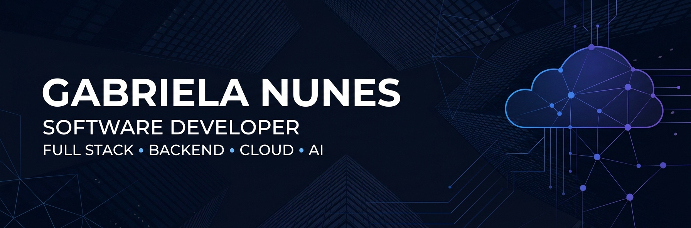

 

  

<h1 align="center">Gabriela Nunes</h1>

  <strong>Desenvolvedora de Software | Full Stack • Backend • Nuvem • IA</strong>

  Desenvolvendo soluções, investigando problemas e aprendendo como os sistemas funcionam por dentro.

---

## 👩‍💻 Sobre mim

Sou estudante de Engenharia de Software e desenvolvedora em formação, com experiência prática no desenvolvimento e na evolução de aplicações web e mobile.

Atuo na implementação de funcionalidades, integração de serviços, investigação e correção de problemas, testes e validação de sistemas. Gosto de compreender a causa dos problemas, entender como os componentes se relacionam e construir soluções com atenção à qualidade e à confiabilidade.

Tenho interesse especial em **desenvolvimento backend, arquitetura de software, computação em nuvem e inteligência artificial**, buscando evoluir continuamente por meio de experiências práticas e estudos.

## 🛠️ Tecnologias e ferramentas

**Linguagens de programação**

  
  
  
  
  
  

**Desenvolvimento web e mobile**

  
  
  
  

**Backend e computação em nuvem**

  
  
  
  
  

**Ferramentas e práticas de desenvolvimento**

  
  
  

- Investigação e depuração de problemas
- Testes automatizados e manuais
- Validação funcional e garantia da qualidade
- Integração entre serviços
- Documentação técnica
- Controle de versão e revisão de código

## 🚀 No momento, estou me aprofundando em

- Desenvolvimento backend e construção de APIs
- Bancos de dados relacionais e SQL
- Arquitetura de software e organização de código
- Computação em nuvem e segurança
- Integração de inteligência artificial em aplicações

## 🎓 Formação acadêmica

- **Engenharia de Software** — Universidade Pitágoras  
  6º período · Previsão de conclusão: 2027
- **Técnico em Desenvolvimento de Sistemas** — Colégio Pedro II
- **Oracle Next Education (ONE)** — Alura

## 📫 Entre em contato

  
  
  

---

  <strong>CODIFICAR • CONSTRUIR • TRANSFORMAR</strong>

